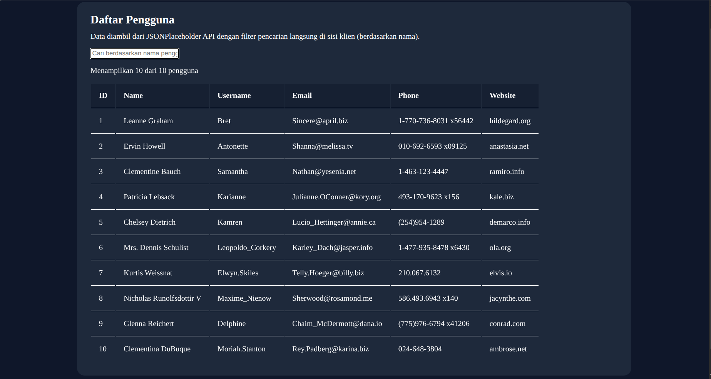
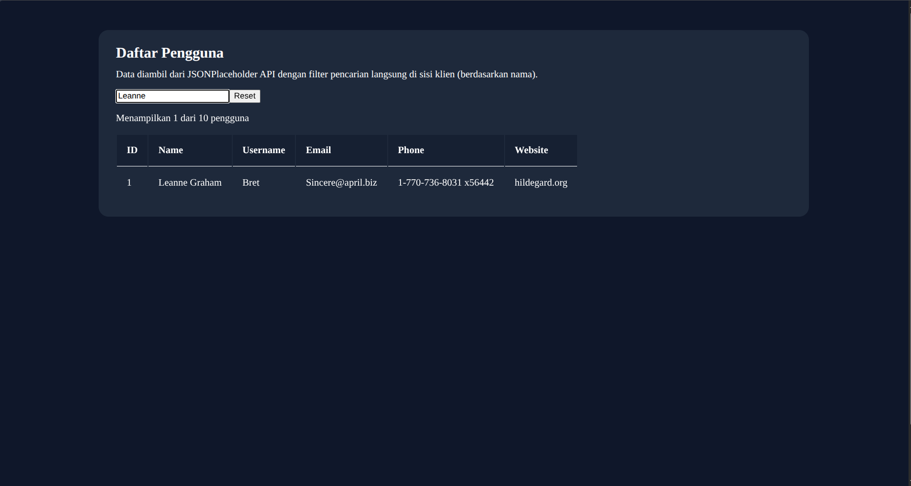

Rafael Putra Septava  
103122400015  
SE-08-01

## Description

Aplikasi yang saya buat ini mengambil data pengguna dari JSONPlaceholder menggunakan axios ketika file App.jsx dimuat di dalam useEffect dengan, mengatur state loading dan error beserta tombol Coba Lagi jika permintaan gagal. Dilanjutkan dengan menyaring daftar pengguna di sisi klien berdasarkan user.name sesuai searchQuery yang diketikkan di SearchBar untuk ditampilkan dalam tabel UserTable atau pesan kosong jika tidak ada yang cocok. Selain itu, komponen SearchBar juga menyediakan tombol reset untuk menghapus kata kunci pencarian serta menampilkan informasi jumlah pengguna yang tampil dibandingkan total data yang tersedia.

## Screenshot

  
  

  
