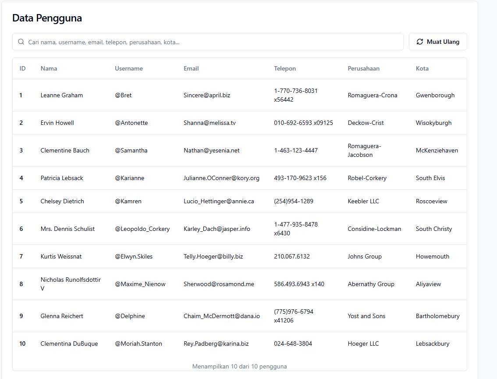
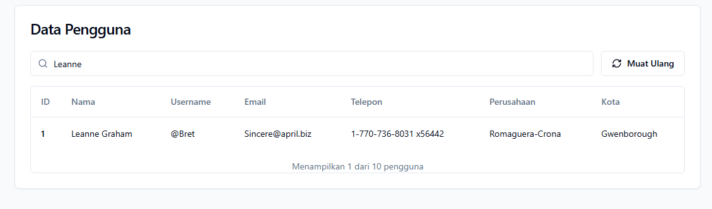

Aplikasi React sederhana yang menampilkan data pengguna dari JSONPlaceholder menggunakan Axios. Saat halaman dibuka, aplikasi mengirim request GET ke endpoint /users secara asynchronous. Pengambilan data dilakukan di dalam useEffect sehingga hanya berjalan sekali ketika komponen pertama kali dimuat, sedangkan hasil respons, kata kunci pencarian, status loading, dan pesan error disimpan serta dikelola dengan useState. Data pengguna ditampilkan dalam tabel dari komponen shadcn/ui yang memuat ID, nama, username, email, nomor telepon, perusahaan, dan kota. Aplikasi juga dilengkapi fitur pencarian secara client-side: data difilter langsung di browser dari state yang sudah ada setiap kali pengguna mengetik, sehingga hasilnya muncul seketika tanpa perlu memanggil API lagi.

## Screenshot Output

### GET — Ambil Data


### Pencarian Client-Side


## Struktur File

```
103122400021_Tony Hendrawan/
├── README.md
├── screenshoots/
│   ├── get_data.png
│   └── search.png
└── source_code/
    ├── package.json
    └── src/
        ├── App.jsx
        └── components/ui/
            └── table.jsx
```
