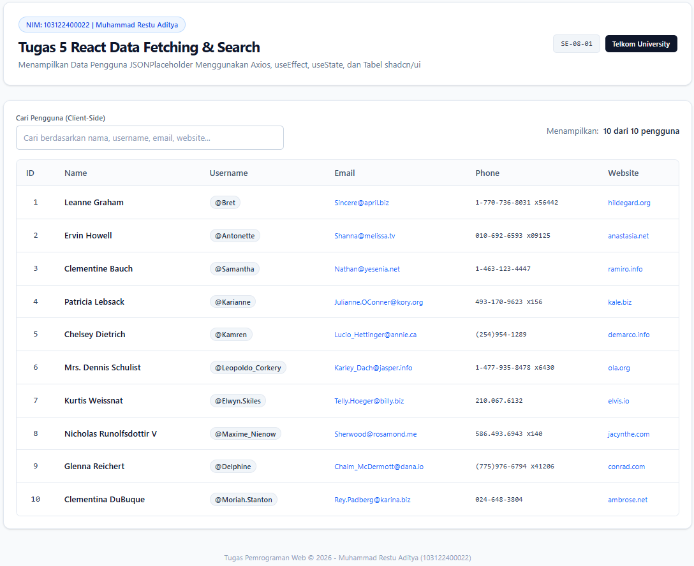
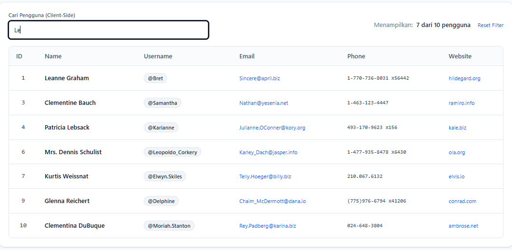

# TUGAS PRAKTIKUM PEMROGRAMAN WEB
## TUGAS 5: REACT DATA FETCHING & SEARCH
### Menampilkan Data Pengguna JSONPlaceholder Menggunakan Axios dan Tabel shadcn/ui

 

 
 

**Disusun Oleh :**

**Muhammad Restu Aditya / 103122400022**  
**SE-08-01**

 

**Asisten Praktikum :**  
Abu Abdirrahman Humaid Al-Atsary  
Hamka Zainul Ardhi

 

**Dosen Pengampu :**  
Arif Amrulloh, S.Kom., M.Kom.

 
 

### PROGRAM STUDI S1 SOFTWARE ENGINEERING
### FAKULTAS INFORMATIKA
### TELKOM UNIVERSITY PURWOKERTO
### 2026

---

## 1. Penjelasan Program

Aplikasi ini merupakan program berbasis React yang dibangun menggunakan bundler Vite untuk mengimplementasikan pengambilan data (*data fetching*) dari REST API eksternal menggunakan pustaka Axios, pengelolaan state menggunakan React Hooks (`useState` dan `useEffect`), serta perenderan data ke dalam komponen tabel modern berbasis shadcn/ui.

Program ini terhubung ke endpoint publik JSONPlaceholder pada alamat `https://jsonplaceholder.typicode.com/users` untuk memuat informasi pengguna secara asinkron. Data yang berhasil diambil langsung disajikan ke dalam tabel terstruktur yang memuat ID, nama, username, email, nomor telepon, dan website. Selain itu, aplikasi dilengkapi fitur pencarian data di sisi klien (*client-side search*) yang memungkinkan penyaringan data secara instan tanpa perlu melakukan panggilan jaringan ulang ke server.

---

## 2. Penjelasan Fitur dan Implementasi Kode

Seluruh logika aplikasi berpusat pada komponen fungsional React yang memanfaatkan React Hooks untuk mengelola siklus hidup komponen dan aliran data.

### 1. Pengambilan Data Pengguna dan Tampilan Tabel

Proses pengambilan data dijalankan secara otomatis saat komponen pertama kali dimuat menggunakan hook `useEffect` dengan array ketergantungan kosong. Di dalam fungsi `fetchUsers()`, pustaka Axios memanggil endpoint `/users` dengan metode GET. Hasil respons yang dikembalikan oleh server kemudian disimpan ke dalam state `users` melalui fungsi `setUsers`. Status pengambilan data dikendalikan secara rapi oleh state `loading` dan `error`, sehingga antarmuka dapat menampilkan indikator animasi pemuatan saat request berlangsung serta memunculkan pesan kesalahan apabila terjadi kendala jaringan. Setelah data selesai dimuat, seluruh baris dipetakan secara dinamis ke dalam komponen tabel semantik bergaya shadcn/ui.

### 2. Fitur Pencarian Pengguna Secara Client-Side

Fitur pencarian bekerja sepenuhnya di peramban pengguna secara lokal tanpa mengirimkan permintaan HTTP baru ke server luar. Input pencarian terhubung langsung ke state `searchTerm` melalui event listener `onChange`. Program menerapkan fungsi `filter()` pada array data untuk mencocokkan kata kunci yang diketikkan pengguna terhadap beberapa atribut data, seperti nama lengkap, username, email, nomor telepon, dan website. Hasil pada tabel akan diperbarui secara seketika mengikuti kata kunci yang dimasukkan, dilengkapi keterangan jumlah data yang berhasil disaring serta tombol reset untuk membatalkan filter. Jika kata kunci tidak menemukan kecocokan, tabel secara informatif menampilkan pesan bahwa data pengguna tidak ditemukan.

---

## 3. Struktur Komponen dan Penataan Tabel shadcn/ui

Antarmuka pengguna disusun menggunakan prinsip modularitas komponen dengan memisahkan elemen tabel ke dalam berkas tersendiri pada folder `components/ui/table.jsx`. Komponen tersebut mencakup elemen semantik HTML seperti `Table`, `TableHeader`, `TableBody`, `TableRow`, `TableHead`, dan `TableCell` yang ditata menggunakan utilitas Tailwind CSS. Pendekatan ini menghasilkan tampilan tabel yang terstruktur, bersih, memiliki kontras warna yang nyaman, dilengkapi efek sorot baris (*row hover*), serta menyematkan watermark identitas mahasiswa secara jelas di bagian kepala halaman sebagai penanda kepemilikan karya praktikum.

