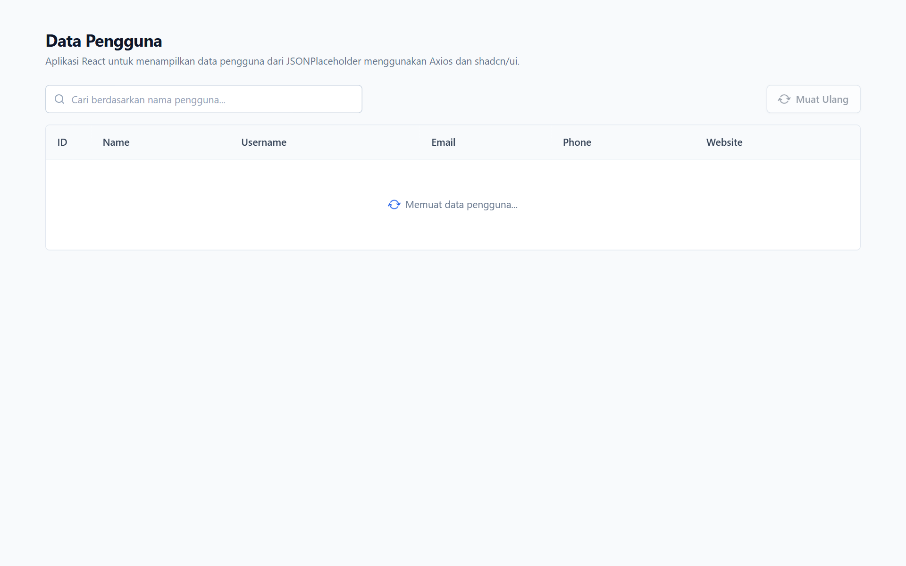
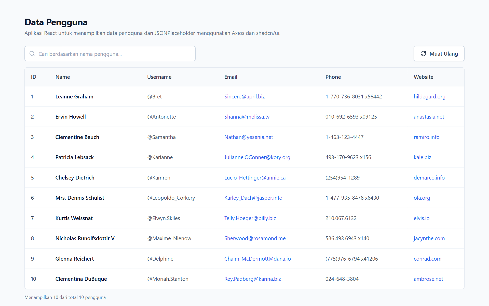
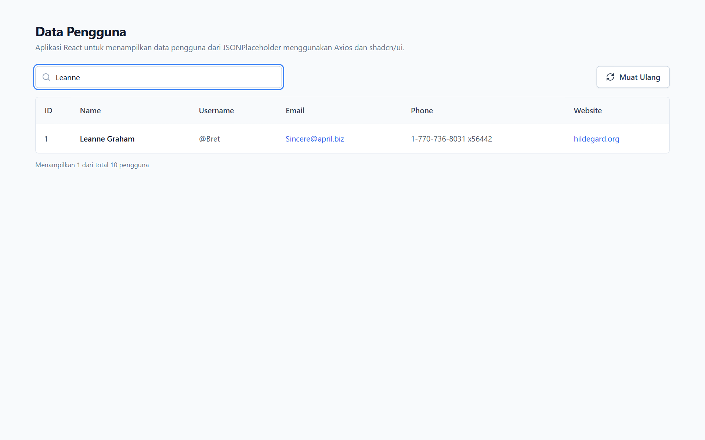
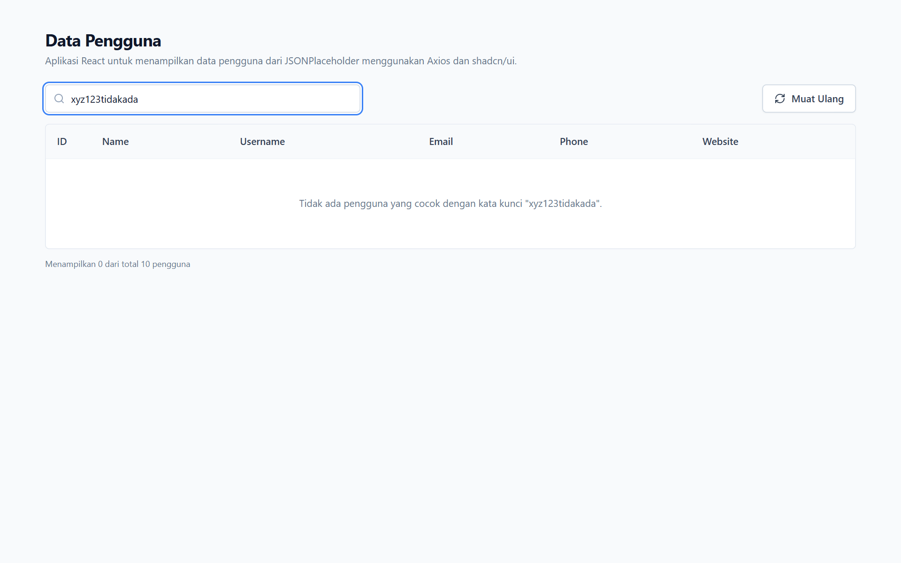
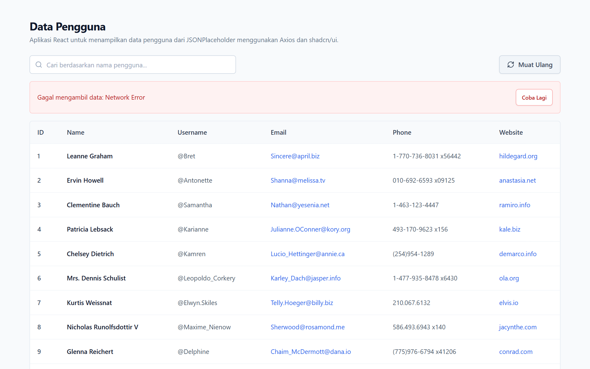

# Modul-7-React-Data-Fetching-dan-Search

# Tugas Praktikum Pemrograman Web

## React Data Fetching & Search

Aplikasi web sederhana berbasis React untuk menampilkan daftar data pengguna (users) yang diambil dari REST API JSONPlaceholder menggunakan Axios. Data dikelola menggunakan React Hooks (useState dan useEffect), ditampilkan menggunakan komponen Table dari shadcn/ui, serta dilengkapi dengan fitur pencarian client-side berdasarkan nama pengguna.

### Identitas Mahasiswa

- **Nama:** Geusan Edurais Aria Daffa
- **NIM:** 103122400026
- **Kelas:** SE-08-01

---

### Screenshot Output

#### 1. Instalasi dan Setup Vite
Inisialisasi proyek React menggunakan Vite serta instalasi dependensi yang dibutuhkan (Axios, Tailwind CSS, shadcn/ui Table, Lucide React).


#### 2. Loading State
Tampilan indikator saat proses pengambilan data pengguna dari API JSONPlaceholder sedang berlangsung.


#### 3. GET Data Pengguna
Tampilan data pengguna yang berhasil diambil dari API dan disajikan dalam bentuk tabel menggunakan komponen Table dari shadcn/ui (memuat kolom ID, Name, Username, Email, Phone, dan Website).


#### 4. Fitur Pencarian Client-Side
Proses pemfilteran data pengguna secara langsung pada sisi klien berdasarkan nama pengguna yang dimasukkan pada input pencarian tanpa melakukan request ulang ke server.


#### 5. Data Tidak Ditemukan
Tampilan pesan informatif ketika kata kunci pencarian yang dimasukkan tidak cocok dengan nama pengguna manapun.


#### 6. Penanganan Error
Tampilan penanganan pesan error ketika terjadi kendala jaringan saat memuat data dari server, dilengkapi tombol coba lagi untuk memuat ulang data.


---

### Struktur File

```
103122400026_Geusan Edurais Aria Daffa/
├── README.md
├── assets/
│   ├── empty_state.png
│   ├── error_state.png
│   ├── get_data.png
│   ├── instalasi vite.png
│   ├── loading_state.png
│   └── pencarian_nama.png
└── source_code/
    ├── src/
    │   ├── components/
    │   │   └── ui/
    │   │       ├── button.jsx
    │   │       ├── input.jsx
    │   │       └── table.jsx
    │   ├── lib/
    │   │   └── utils.js
    │   ├── App.jsx
    │   ├── index.css
    │   └── main.jsx
    ├── index.html
    ├── package.json
    ├── package-lock.json
    ├── postcss.config.js
    ├── tailwind.config.js
    └── vite.config.js
```

---

### Cara Menjalankan Proyek

1. Masuk ke direktori `source_code`:
   ```bash
   cd source_code
   ```
2. Instal semua dependensi:
   ```bash
   npm install
   ```
3. Jalankan development server:
   ```bash
   npm run dev
   ```
4. Buka di browser pada alamat yang muncul di terminal (biasanya `http://localhost:5173/`).
