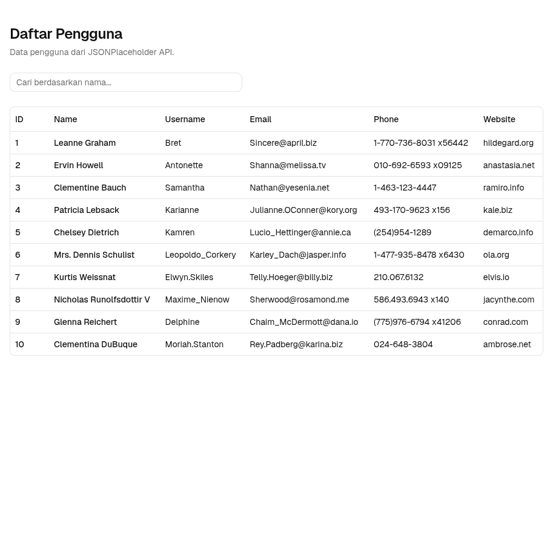
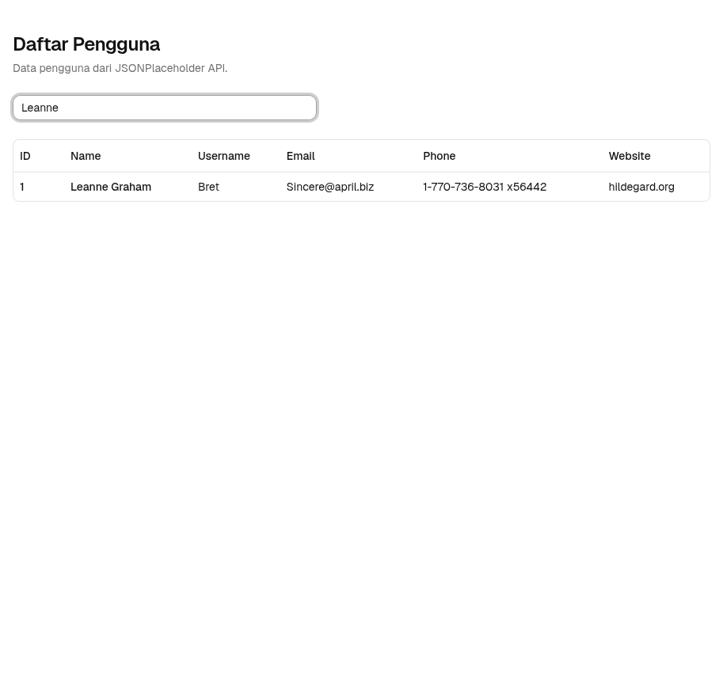
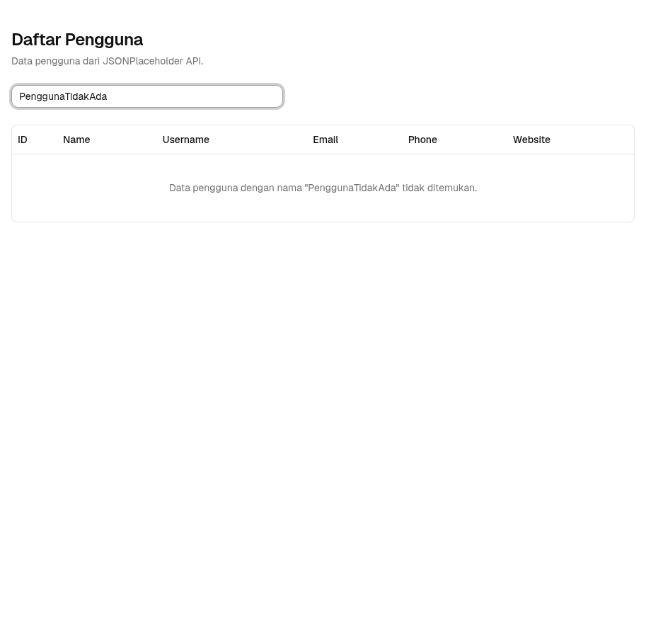

# Laporan Tugas 5 — React Data Fetching & Search

## Identitas Mahasiswa

- **Nama:** Ryvanda
- **NIM:** 103122400027
- **Kelas:** SE 08-01

---

## Deskripsi Aplikasi

Aplikasi React sederhana untuk mengambil dan menampilkan data pengguna (*users*) dari API publik [JSONPlaceholder](https://jsonplaceholder.typicode.com/users) menggunakan **Axios**, **React Hooks** (`useState`, `useEffect`), dan komponen **shadcn/ui** (`Table` dan `Input`).

Saat halaman dibuka, aplikasi mengirim request `GET` ke endpoint `/users` secara asinkron di dalam `useEffect` agar berjalan sekali saat komponen pertama kali dimuat. Hasil respons API, kata kunci pencarian, status loading, dan pesan error disimpan serta dikelola menggunakan `useState`. Data ditampilkan dalam tabel `shadcn/ui` dan dilengkapi fitur pencarian *client-side* langsung dari state tanpa melakukan request ulang ke server.

---

## Ketentuan & Implementasi

### 1. Pengambilan Data API (`useEffect` & `Axios`)
Pada [src/App.tsx](./src/App.tsx), pengambilan data dilakukan menggunakan `axios.get` di dalam `useEffect` dengan *dependency array* kosong (`[]`) serta `AbortController` untuk cleanup:

```tsx
useEffect(() => {
  const controller = new AbortController()

  const fetchUsers = async () => {
    try {
      const response = await axios.get<User[]>(USERS_API_URL, {
        signal: controller.signal,
      })
      setUsers(response.data)
      setError(null)
    } catch (err) {
      if (
        axios.isCancel(err) ||
        (axios.isAxiosError(err) && err.code === "ERR_CANCELED")
      ) {
        return
      }
      setError(
        "Gagal memuat data pengguna. Silakan periksa koneksi internet Anda."
      )
    } finally {
      if (!controller.signal.aborted) {
        setLoading(false)
      }
    }
  }

  void fetchUsers()

  return () => {
    controller.abort()
  }
}, [])
```

### 2. Pencarian *Client-Side*
Data pengguna pada state `users` disaring langsung di sisi klien secara *case-insensitive* berdasarkan nama (`name`) tanpa mengirim permintaan baru ke server:

```tsx
const filteredUsers = users.filter((user) =>
  user.name.toLowerCase().includes(search.trim().toLowerCase())
)
```

### 3. Penyajian Data & Penanganan Kondisi UI
- **Tabel Data (`shadcn/ui`):** Menggunakan komponen `Table`, `TableHeader`, `TableBody`, `TableRow`, `TableHead`, dan `TableCell` untuk menampilkan kolom `ID`, `Name`, `Username`, `Email`, `Phone`, dan `Website`.
- **Loading State:** Menampilkan teks `"Memuat data pengguna..."` selama `loading` bernilai `true`.
- **Error State:** Menampilkan pesan error berwarna merah (`text-destructive`) apabila pengambilan data dari API gagal.
- **Empty State:** Menampilkan pesan `Data pengguna dengan nama "..." tidak ditemukan.` apabila tidak ada data yang sesuai kata kunci.

---

## Struktur File

```text
103122400027_Ryvanda/
├── README.md
├── assets/
│   ├── data-tidak-ditemukan.png
│   ├── hasil-pencarian.png
│   └── tampilan-awal.png
├── components.json
├── index.html
├── package.json
├── tsconfig.json
├── vite.config.ts
└── src/
    ├── App.tsx
    ├── index.css
    ├── main.tsx
    ├── components/
    │   └── ui/
    │       ├── input.tsx
    │       └── table.tsx
    ├── lib/
    │   └── utils.ts
    └── types/
        └── user.ts
```

---

## Cara Menjalankan Aplikasi

1. Pastikan Node.js sudah terinstal di komputer Anda.
2. Masuk ke direktori project:
   ```bash
   cd 103122400027_Ryvanda
   ```
3. Pasang seluruh dependensi:
   ```bash
   npm install
   ```
4. Jalankan server pengembangan:
   ```bash
   npm run dev
   ```
5. Buka URL lokal yang muncul di terminal (umumnya `http://localhost:5173`).
6. Untuk build produksi:
   ```bash
   npm run build
   ```

---

## Screenshot Output

### 1. GET — Tampilan Awal (Daftar Pengguna)


### 2. Pencarian *Client-Side*


### 3. Data Tidak Ditemukan

