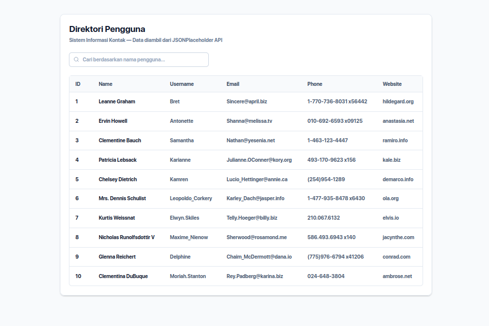
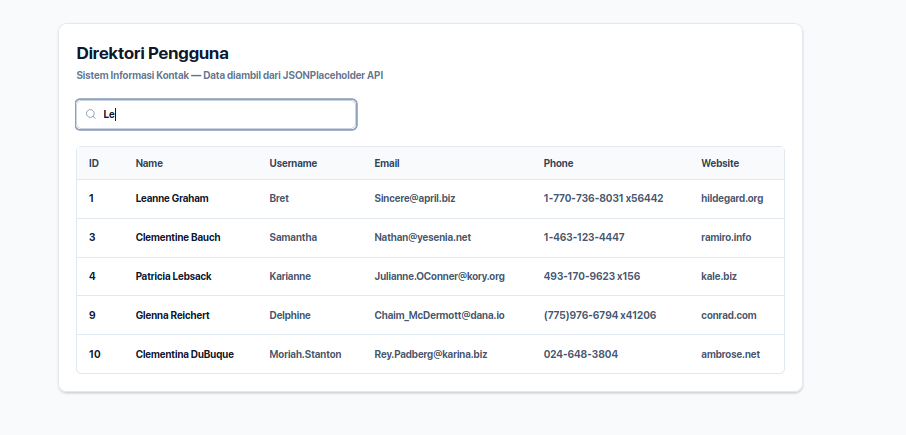
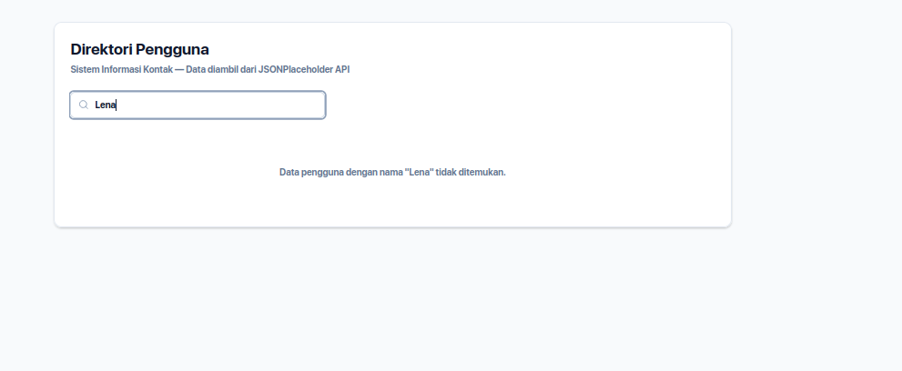

# Laporan Tugas 5 — React Data Fetching & Search

## 1. Instruksi Soal

Buat sebuah aplikasi React sederhana untuk menampilkan data pengguna (*users*) yang diperoleh dari API [JSONPlaceholder](https://jsonplaceholder.typicode.com/users) dengan ketentuan sebagai berikut:

1. **Setup Project:** Menggunakan React, Axios untuk HTTP request, `useState` dan `useEffect` dari React, serta komponen `Table` dari **shadcn/ui**.
2. **Mengambil Data dari API:** Mengambil data dari endpoint `https://jsonplaceholder.typicode.com/users` menggunakan `axios.get()` di dalam `useEffect` saat komponen pertama kali dimuat, lalu menyimpannya ke dalam state menggunakan `useState`.
3. **Menampilkan Data Pengguna:** Menampilkan data pengguna ke dalam komponen `Table` shadcn/ui dengan kolom minimal: `ID`, `Name`, `Username`, `Email`, `Phone`, dan `Website`.
4. **Fitur Pencarian:** Menyediakan input pencarian di atas tabel yang melakukan filter secara *client-side* (langsung dari state tanpa request ulang ke server) minimal berdasarkan `name`.
5. **Tampilan dan Pengalaman Pengguna:** Memiliki tampilan tabel yang rapi, input pencarian yang jelas, indikator *loading* saat mengambil data, pesan error yang informatif apabila gagal memuat data, serta pesan apabila hasil pencarian tidak ditemukan.

---

## 2. Identitas Mahasiswa

- **Nama:** Davis Arvaputra Dwiansyah
- **NIM:** 103122400034

---

## 3. Jawaban & Implementasi

### A. Pengambilan Data API (`useEffect` & `Axios`)
Pada file `src/App.jsx`, proses pengambilan data dilakukan menggunakan `axios.get` di dalam hook `useEffect` dengan *dependency array* kosong (`[]`) agar hanya dijalankan satu kali saat komponen pertama kali dimuat:

```jsx
useEffect(() => {
  axios
    .get('https://jsonplaceholder.typicode.com/users')
    .then((response) => {
      setUsers(response.data)
      setLoading(false)
    })
    .catch(() => {
      setError('Gagal memuat data pengguna. Silakan periksa koneksi internet Anda.')
      setLoading(false)
    })
}, [])
```

### B. Pencarian *Client-Side*
Data yang telah disimpan di state `users` difilter secara langsung menggunakan method `.filter()` berdasarkan kata kunci pada state `search` (pencarian berdasarkan `name` secara *case-insensitive*):

```jsx
const filteredUsers = users.filter((user) =>
  user.name.toLowerCase().includes(search.toLowerCase())
)
```

### C. Penyajian Data & Penanganan Kondisi UI
- **Loading State:** Menampilkan teks `"Memuat data pengguna..."` selama `loading` bernilai `true`.
- **Error State:** Menampilkan pesan peringatan berwarna merah apabila request API gagal.
- **Empty State:** Menampilkan pesan `"Data pengguna dengan nama "..." tidak ditemukan."` apabila hasil filter kosong.
- **Tabel Data:** Menggunakan komponen `Table`, `TableHeader`, `TableBody`, `TableRow`, `TableHead`, dan `TableCell` dari **shadcn/ui** untuk menampilkan kolom `ID`, `Name`, `Username`, `Email`, `Phone`, dan `Website`.

### D. Output Gambar
Berikut adalah dokumentasi hasil tampilan aplikasi (simpan tangkapan layar pada folder `docs/`):

1. **Tampilan Awal / Daftar Pengguna**  
   

2. **Tampilan Fitur Pencarian**  
   

3. **Tampilan Data Tidak Ditemukan**  
   

---

## 4. Deskripsi Proyek

Aplikasi **Direktori Pengguna (Sistem Informasi Kontak)** ini merupakan aplikasi web berbasis React yang dirancang untuk menampilkan dan mencari informasi kontak pengguna secara cepat dan responsif. Data pengguna diambil secara asinkron dari REST API publik JSONPlaceholder menggunakan library **Axios**, dikelola menggunakan **React Hooks** (`useState` dan `useEffect`), serta disajikan dengan antarmuka modern menggunakan **Tailwind CSS** dan komponen **shadcn/ui**.
